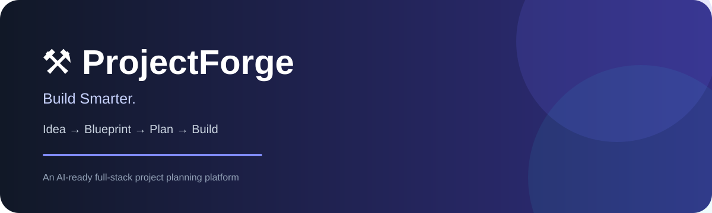
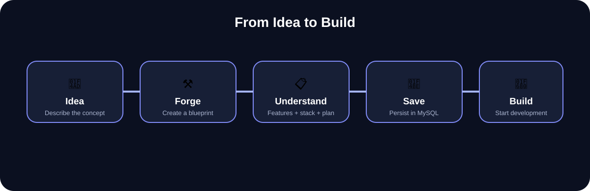
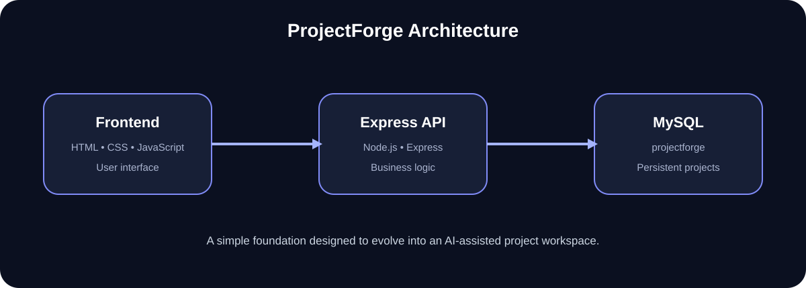

# ⚒️ ProjectForge

<p align="center">
  
</p>

<p align="center">
  <strong>Turn a software idea into a build-ready project blueprint.</strong><br>
  ProjectForge helps developers transform rough ideas into structured project plans with features, technology choices, architecture direction, tasks, and complexity insights.
</p>

<p align="center">
  
  
  
  
</p>

---

## 💡 Overview

Turning a software idea into an actual project can be difficult.

A developer may start with something as simple as:

> "I want to build an application that helps students manage their projects."

But before development can begin, several questions need to be answered:

* What problem does the project solve?
* Who are the intended users?
* What features are required?
* Which technologies should be used?
* How should the system be structured?
* What should be implemented first?
* How complex is the project?

**ProjectForge is designed to bridge this gap.**

It transforms a rough software idea into a structured project blueprint that provides a clearer starting point for development.

---

## 🚀 What is ProjectForge?

ProjectForge is a full-stack project planning and ideation platform designed around the workflow:

```text
Idea → Blueprint → Development
```

Instead of producing only a general description, ProjectForge organizes an idea into multiple development-oriented components:

* 🎯 Project title
* 📝 Project description
* 🧩 Project type
* 🛠️ Technology stack
* ✨ Core features
* 🏗️ Architecture direction
* 📋 Development tasks
* 📊 Complexity assessment
* ⏱️ Estimated development time
* 💾 Project data

The goal is simple:

> **Move from "I have an idea" to "I know what to build next."**

---

## ✨ Key Features

| Feature                    | Description                                         |
| -------------------------- | --------------------------------------------------- |
| 💭 Idea Input              | Describe a software project using natural language  |
| 🧠 Blueprint Generation    | Convert an idea into structured project information |
| 🛠️ Technology Suggestions | Identify technologies suitable for the project      |
| ✨ Feature Breakdown        | Convert a concept into concrete functionality       |
| 🏗️ Architecture Direction | Provide a starting point for system architecture    |
| 📋 Task Planning           | Break development into actionable tasks             |
| 📊 Complexity Assessment   | Estimate project difficulty                         |
| ⏱️ Time Estimation         | Provide an initial development-time estimate        |
| 🗄️ MySQL Integration      | Provide persistent project data storage             |
| 🔌 REST API Foundation     | Connect the frontend with backend services          |

---

## 🖥️ Product Workflow

<p align="center">
  
</p>

### 01 — Describe

The user enters a rough software idea.

### 02 — Forge

ProjectForge analyzes the input and generates a structured project blueprint.

### 03 — Understand

The generated blueprint provides a clearer view of the project's:

* Features
* Technology stack
* Architecture
* Tasks
* Complexity
* Estimated development time

### 04 — Persist

The backend and MySQL database provide the foundation for storing project information.

### 05 — Build

The blueprint becomes the starting point for actual implementation.

---

## 🏗️ System Architecture

<p align="center">
  
</p>

The current system follows a straightforward full-stack architecture:

```text
┌──────────────────────────┐
│        Frontend          │
│     HTML / CSS / JS      │
└────────────┬─────────────┘
             │
             │ HTTP Requests
             ▼
┌──────────────────────────┐
│      Express API         │
│        Node.js           │
└────────────┬─────────────┘
             │
             │ SQL Queries
             ▼
┌──────────────────────────┐
│          MySQL           │
│       projectforge       │
└──────────────────────────┘
```

This architecture keeps the current system simple while providing a foundation for future AI-assisted project planning and project-management capabilities.

---

## 📸 Screenshots

### Landing Page


### Generated Project Blueprint


### Project Results


---

## 🧰 Tech Stack

### Frontend

* HTML5
* CSS3
* JavaScript

### Backend

* Node.js
* Express.js

### Database

* MySQL 8

### Development Tools

* VS Code
* Git
* GitHub

---

## 📂 Project Structure

```text
ProjectForge/
│
├── index.html
├── style.css
├── script.js
│
├── backend/
│   ├── db.js
│   ├── server.js
│   ├── package.json
│   └── package-lock.json
│
├── assets/
│   ├── projectforge-banner.svg
│   ├── architecture.svg
│   └── workflow.svg
│
├── .gitignore
└── README.md
```

---

## 🗄️ Database

ProjectForge uses a MySQL database named:

```text
projectforge
```

The primary project table is:

```text
projects
```

The project model includes fields such as:

```text
id
title
idea
project_type
description
tech_stack
features
tasks
architecture
complexity_score
complexity_level
estimated_time
created_at
```

This database structure provides the foundation for turning generated project blueprints into persistent application data.

---

## 🔌 Backend API

The backend is built using **Node.js and Express.js**.

During local development, the backend runs on:

```text
http://localhost:5000
```

### Database Health Check

A database connectivity endpoint is available:

```http
GET /api/test-db
```

The backend provides the foundation for:

* Project creation
* Project retrieval
* Database connectivity
* Future project-management operations

---

## ⚙️ Run Locally

### Prerequisites

Make sure the following are installed:

* Node.js
* npm
* MySQL 8
* Git

### 1. Clone the repository

```bash
git clone <YOUR-GITHUB-REPOSITORY-URL>
cd ProjectForge
```

### 2. Install backend dependencies

```bash
cd backend
npm install
```

### 3. Create the database

Open MySQL and run:

```sql
CREATE DATABASE projectforge;
```

Create the required `projects` table according to the schema used by:

```text
backend/db.js
```

### 4. Configure environment variables

Create:

```text
backend/.env
```

Add:

```env
DB_HOST=localhost
DB_USER=root
DB_PASSWORD=your_password
DB_NAME=projectforge
PORT=5000
```

### 5. Start the backend

```bash
node server.js
```

The server should start on:

```text
http://localhost:5000
```

### 6. Launch the frontend

Open `index.html` using a local development server.

For example, you can use the **Live Server** extension in VS Code.

---

## 🔐 Security

Never commit credentials or environment files to GitHub.

Your `.gitignore` should contain:

```gitignore
.env
node_modules/
```

Keep database credentials and other sensitive configuration inside environment variables.

---

## 🧠 Future AI Vision

ProjectForge is currently built around a full-stack project-planning foundation.

The long-term vision is to evolve it into an **AI-assisted project engineering workspace**.

### Current Direction

```text
User Idea
    ↓
Project Analysis
    ↓
Structured Blueprint
    ↓
Database
```

### Future Direction

```text
                    User Idea
                        │
                        ▼
              ┌───────────────────┐
              │ AI Project Planner│
              └─────────┬─────────┘
                        │
       ┌────────────────┼────────────────┐
       ▼                ▼                ▼
 Problem Analysis  Feature Planning  Tech Selection
       │                │                │
       └────────────────┼────────────────┘
                        ▼
              Architecture Planning
                        │
                        ▼
                Database Design
                        │
                        ▼
               API Planning
                        │
                        ▼
              Development Roadmap
                        │
                        ▼
                Project Workspace
```

Potential future capabilities include:

* AI-assisted project analysis
* Automatic feature decomposition
* Database schema generation
* API endpoint recommendations
* Architecture generation
* Development roadmap generation
* Project documentation generation
* Code-generation assistance

---

## 🗺️ Roadmap

### Completed

* [x] ProjectForge landing page
* [x] Idea input interface
* [x] Project blueprint generation
* [x] Node.js backend
* [x] Express API foundation
* [x] MySQL integration
* [x] Database connectivity
* [x] Project planning data model
* [x] Initial project persistence foundation

### In Progress

* [ ] Complete blueprint persistence
* [ ] Saved projects dashboard
* [ ] Project search and filtering
* [ ] Improved project validation
* [ ] Cloud deployment

### Planned

* [ ] AI-powered project planning
* [ ] Automatic database schema generation
* [ ] API endpoint recommendations
* [ ] Development roadmap generation
* [ ] Authentication
* [ ] Project blueprint export
* [ ] Project workspace
* [ ] AI-assisted development features

---

## 🎯 Design Philosophy

ProjectForge focuses on the transition between an idea and implementation.

The core workflow is:

```text
Idea
 ↓
Problem
 ↓
Features
 ↓
Technology
 ↓
Architecture
 ↓
Tasks
 ↓
Development
```

The objective is not simply to generate an answer to a project idea.

It is to create a **structured starting point for building the project**.

---

## 📚 What This Project Demonstrates

ProjectForge demonstrates practical experience with:

* Full-stack web development
* Frontend development
* REST API fundamentals
* Node.js and Express.js
* MySQL database integration
* CRUD-oriented application design
* Frontend/backend communication
* Environment variables
* Git and GitHub workflow
* Product-oriented UI design
* Database-backed applications
* Designing systems with future AI integration in mind

---

## 👩‍💻 Developer

**Surabhi**

ProjectForge is a hands-on full-stack project focused on transforming software ideas into structured and actionable development plans.

---

## ⭐ Support

If you find ProjectForge useful or interesting, consider giving the repository a ⭐ on GitHub.

---

<p align="center">
  <strong>ProjectForge — Build Smarter.</strong><br>
  <sub>From a rough idea to a clear path forward.</sub>
</p>
